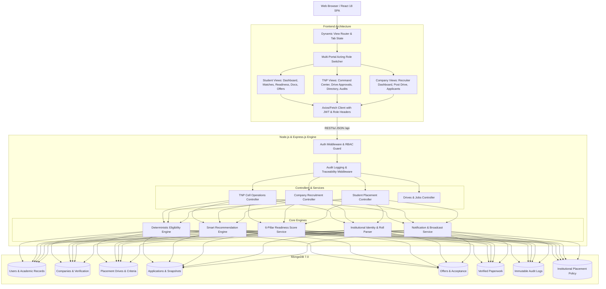

# Placement Management System (PMS) — System Architecture

## 1. Executive Summary & Ecosystem Overview
The **Placement Management System (PMS)** is an institutional, multi-sided ecosystem designed to digitize, automate, and govern university campus recruitment operations across three interconnected domains:
1. **Student Portal:** Provides transparent, explainable eligibility, smart drive recommendations, placement readiness diagnostics (6 pillars), paperless document verification, application tracking, and offer acceptance workflows.
2. **TNP (Training & Placement) Cell Portal:** Serves as the central institutional command layer with company request governance (mandatory rejection reasons), student academic override controls, missing-link funnel investigation, live drive health monitoring, placement policy configuration, and immutable audit trails.
3. **Company / Recruiter Portal:** Empowers corporate talent acquisition teams to submit hiring drives, specify granular academic eligibility thresholds, review matching candidates, advance selection rounds, and release formal digital placement offers.

---

## 2. Architectural Blueprint & Layers



---

## 3. Core Architectural Modules

### 3.1 Deterministic Eligibility Engine (`backend/src/services/EligibilityEngine.js`)
* **Purpose:** Performs transparent, mathematical evaluation of student academic and behavioral profiles against company-defined criteria.
* **Checks:**
  - Cutoff CGPA (`student.cgpa >= criteria.minCgpa`)
  - Active backlogs restriction (`student.activeBacklogs <= criteria.maxBacklogs`)
  - Institutional attendance percentage (`student.attendancePercentage >= criteria.minAttendance`)
  - Allowed academic branches (`criteria.allowedBranches.includes(student.branch)`)
  - 10th and 12th board percentages (`10th% >= criteria.min10thPercentage`)
  - Graduation batch year matching
* **Output:** Produces boolean `isEligible`, exact `matchPercentage`, lists of `passedChecks`, `failedChecks`, and `missingRequirements` with full human-readable explanations.

### 3.2 Smart Recommendation Engine (`backend/src/services/RecommendationEngine.js`)
* **Categorization:**
  - **High-Fit Recommendations ($\ge 80\%$ Match):** High academic alignment, no backlog restrictions, matching technical skills.
  - **Eligible Opportunities ($50\% - 79\%$ Match):** Meets all minimum institutional thresholds with minor skill delta.
  - **Near-Match Drives:** Marginal gap (e.g., specific certification or minor attendance deficit).
  - **Ineligible Drives:** Transparently explains why student cannot participate.

### 3.3 6-Pillar Placement Readiness Diagnostic (`backend/src/services/ReadinessScoreService.js`)
* **Pillars Evaluated (0–100 total):**
  1. *Academic Standing (20 pts):* CGPA, zero backlogs, attendance.
  2. *Profile Completeness (20 pts):* Bio, contact details, social/GitHub/LinkedIn profiles.
  3. *Resume & Portfolio (20 pts):* Active verified resume, portfolio links.
  4. *Verified Documents (15 pts):* Approved semester marksheets, ID verification.
  5. *Technical Skills (15 pts):* Minimum 5+ industry-aligned skills added.
  6. *Preparation & Attendance (10 pts):* Mock test & placement training participation.
* **Actionable Next Steps:** Generates targeted checklist to improve placement score.

### 3.4 Institutional Identity & Email Parser (`backend/src/services/IdentityParser.js`)
* **Institutional Domain Validation:** Configured for `giet.edu` and institutional patterns.
* **Extraction:** Parses `231CS001.faizaan@giet.edu` into Roll Number `231CS001`, First Name `Faizaan`, and Domain `giet.edu` with fallback validation.

### 3.5 Immutable Audit Logging Service (`backend/src/services/AuditService.js`)
* **Zero Mutation:** All critical operations (drive review decisions, document approvals, rejections with reasons, student academic overrides, offer acceptance) produce an unalterable audit document in MongoDB with timestamp, actor ID, actor role, IP address, and change deltas.

---

## 4. Frontend Component Hierarchy
```
frontend/src/
├── App.tsx                     # Top router, global state, modal coordination
├── components/
│   ├── common/
│   │   ├── Header.tsx          # Real-time Acting Role Switcher, Alerts, User info
│   │   ├── Sidebar.tsx         # Role-aware navigation (Student vs TNP vs Company)
│   │   └── ApplicationModal.tsx# Job description and application modal
│   ├── StudentDashboard/
│   │   ├── DashboardView.tsx   # Preserved student portal home with live stats
│   │   ├── RecommendationsView.tsx # High-fit drives with explainability triggers
│   │   ├── ReadinessScoreView.tsx  # 6-pillar visual breakdown and action steps
│   │   ├── DocumentsView.tsx   # Paperwork management & TNP submission
│   │   ├── OffersView.tsx      # Formal placement offers & accept/decline
│   │   └── EligibilityModal.tsx# Transparent passed/failed evaluation modal
│   ├── TnpPortal/
│   │   ├── TnpDashboardView.tsx# Institutional KPIs, Funnel, Missing Link, Health
│   │   ├── CompanyRequestsView.tsx # Drive approvals/corrections/decline with reasons
│   │   ├── TnpStudentsView.tsx # Directory with academic override controls
│   │   ├── TnpDocumentsView.tsx# Student paperwork verification and rejection
│   │   ├── TnpCasesView.tsx    # Student issue resolution tickets
│   │   ├── TnpPolicyView.tsx   # College placement policy settings
│   │   └── TnpAuditView.tsx    # Immutable compliance audit log viewer
│   └── CompanyPortal/
│       ├── CompanyDashboardView.tsx # Recruiter metrics and campus drives
│       ├── CreateDriveView.tsx # Multi-stage drive creation with criteria
│       └── CompanyApplicantsView.tsx# Candidate review, match %, shortlist, offer
└── services/
    └── api.ts                  # Centralized API service with x-acting-role injection
```
