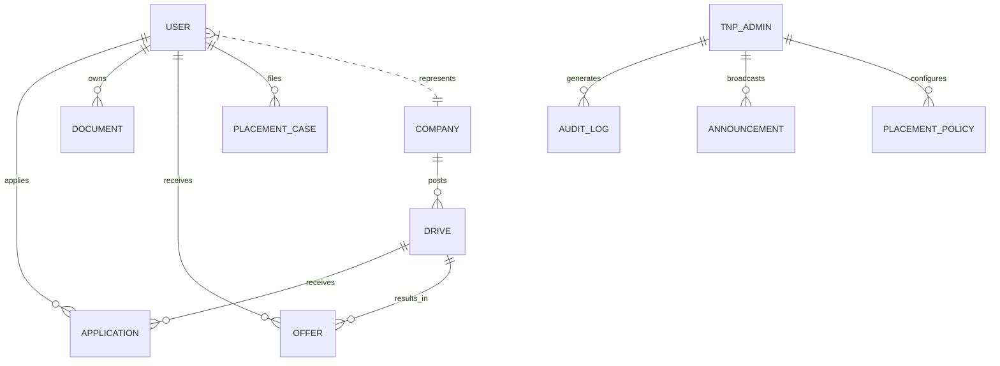

# Database Architecture & Schema Reference

## 1. Database Overview
* **Database Engine:** MongoDB 7.0+ (NoSQL Document Store with Schema Validation via Mongoose ODM)
* **Default Database:** `tnp_database`
* **Connection String:** `mongodb://127.0.0.1:27017/tnp_database`

---

## 2. Entity-Relationship Diagram (Conceptual)



---

## 3. Collections & Schemas

### 3.1 `users` Collection (`backend/src/models/User.js`)
Stores authentication credentials, RBAC roles, student academic profiles, and placement states.
* **Fields:**
  - `name` (String, Required, Trimmed)
  - `email` (String, Required, Unique, Lowercase, Indexed)
  - `password` (String, Bcrypt hashed, Salt rounds: 10)
  - `role` (Enum: `STUDENT`, `COMPANY`, `TNP`, `TNP_ADMIN`, `SUPER_ADMIN`)
  - `phone`, `location`, `avatar`
  - `companyRef` (ObjectId, ref: `Company`)
  - `studentDetails`:
    - `rollNumber` (String, Unique, Indexed)
    - `institutionEmail` (String, Unique)
    - `department`, `branch`, `batchYear`, `graduationYear`, `semester`
    - `cgpa` (Number, 0.0 - 10.0)
    - `percentage10th`, `percentage12th`, `diplomaPercentage`
    - `activeBacklogs` (Number, default: 0)
    - `attendancePercentage` (Number, default: 85.0)
    - `placementStatus` (Enum: `UNPLACED`, `IN_PROCESS`, `SHORTLISTED`, `SELECTED`, `OFFER_RECEIVED`, `OFFER_ACCEPTED`, `PLACED`, `OPTED_OUT`)
    - `skills` (Array of Strings)
    - `certifications`, `projects`, `resumeUrl`

### 3.2 `companies` Collection (`backend/src/models/Company.js`)
Stores verified corporate entity details and HR contacts.
* **Fields:**
  - `name` (String, Required, Unique, Indexed)
  - `legalName`, `industry`, `website`, `headOffice`, `locations`
  - `logoText`, `logoBg`, `description`
  - `hrName`, `hrDesignation`, `hrEmail`, `hrContact`
  - `verificationStatus` (Enum: `REGISTERED`, `PROFILE_SUBMITTED`, `UNDER_REVIEW`, `VERIFIED`, `REJECTED`)
  - `verificationNotes`, `rejectionReason`

### 3.3 `drives` Collection (`backend/src/models/Drive.js`)
Stores placement drives, eligibility rules, and approval workflow status.
* **Fields:**
  - `title`, `role`, `company` (ObjectId, ref: `Company`, Indexed)
  - `companyName` (Denormalized String)
  - `status` (Enum: `DRAFT`, `SUBMITTED`, `UNDER_REVIEW`, `NEEDS_CORRECTION`, `APPROVED`, `PUBLISHED`, `APPLICATIONS_OPEN`, `APPLICATIONS_CLOSED`, `INTERVIEWING`, `COMPLETED`, `CANCELLED`, `REJECTED`)
  - `ctc`, `baseSalary`, `location`, `workMode`
  - `criteria`:
    - `minCgpa` (Number, default: 6.0)
    - `maxBacklogs` (Number, default: 0)
    - `minAttendance` (Number, default: 75.0)
    - `min10thPercentage`, `min12thPercentage`
    - `allowedBranches` (Array of Strings, e.g. `['CSE', 'IT']`)
    - `allowedGraduationYears` (Array of Numbers, e.g. `[2027]`)
    - `requiredSkills`, `preferredSkills`
  - `selectionRounds` (Array of rounds with name, date, mode)
  - `rejectionReason`, `correctionComments`, `internalTnpNotes`

### 3.4 `applications` Collection (`backend/src/models/Application.js`)
Stores student submissions with immutable eligibility snapshots.
* **Compound Index:** `{ student: 1, drive: 1 }` (Unique constraint preventing duplicate applications).
* **Fields:**
  - `student` (ObjectId, ref: `User`, Indexed)
  - `drive` (ObjectId, ref: `Drive`, Indexed)
  - `status` (Enum: `APPLIED`, `SHORTLISTED`, `ROUND_1`, `ROUND_2`, `FINAL_INTERVIEW`, `SELECTED`, `OFFERED`, `ACCEPTED`, `REJECTED`, `WITHDRAWN`)
  - `eligibilitySnapshot`:
    - `cgpa`, `backlogs`, `attendance`, `branch`
    - `isEligible` (Boolean)
    - `matchPercentage` (Number)
    - `evaluatedAt` (Date)
  - `roundResults` (Array of round outcomes)

### 3.5 `offers` Collection (`backend/src/models/Offer.js`)
Manages formal corporate job offers and student responses.
* **Fields:**
  - `student` (ObjectId, ref: `User`, Indexed)
  - `company` (ObjectId, ref: `Company`, Indexed)
  - `drive` (ObjectId, ref: `Drive`, Indexed)
  - `role`, `packageCtc`, `baseSalary`, `joiningDate`, `validUntil`
  - `status` (Enum: `DRAFT`, `RELEASED`, `VIEWED`, `ACCEPTED`, `DECLINED`, `EXPIRED`, `WITHDRAWN`)
  - `declineReason` (String)

### 3.6 `documents` Collection (`backend/src/models/Document.js`)
Digital placement paperwork and verification states.
* **Fields:**
  - `owner` (ObjectId, ref: `User`, Indexed)
  - `type` (Enum: `RESUME`, `10TH_MARKSHEET`, `12TH_MARKSHEET`, `SEMESTER_MARKSHEET`, `ID_PROOF`, `CERTIFICATE`, `OTHER`)
  - `fileUrl`, `fileName`, `fileSize`, `mimeType`
  - `status` (Enum: `UPLOADED`, `UNDER_REVIEW`, `VERIFIED`, `REJECTED`, `REPLACEMENT_REQUIRED`)
  - `verifiedBy` (ObjectId, ref: `User`)
  - `rejectionReason` (Mandatory if rejected)

### 3.7 `audit_logs` Collection (`backend/src/models/AuditLog.js`)
Immutable compliance trail for institutional transparency.
* **Fields:**
  - `actor` (ObjectId, ref: `User`, Indexed)
  - `actorRole` (String, Indexed)
  - `action` (String, e.g. `DRIVE_APPROVED`, `DOCUMENT_REJECTED`, `STUDENT_ACADEMIC_OVERRIDE`)
  - `entityType` (Enum: `DRIVE`, `STUDENT`, `DOCUMENT`, `OFFER`, `POLICY`, `COMPANY`)
  - `entityId` (String, Indexed)
  - `oldValue`, `newValue` (Mixed JSON state)
  - `ipAddress`, `userAgent`, `timestamp` (Date, Indexed)

---

## 4. State Machines

### 4.1 Drive Approval & Lifecycle State Machine
```
[DRAFT] 
   └── submit -> [SUBMITTED / UNDER_REVIEW]
                       ├── request changes -> [NEEDS_CORRECTION] ── resubmit ──┐
                       ├── decline (requires reason) -> [REJECTED]             │
                       └── approve -> [APPROVED] <─────────────────────────────┘
                                          └── publish -> [APPLICATIONS_OPEN]
                                                             └── close -> [INTERVIEWING]
                                                                              └── complete -> [COMPLETED]
```

### 4.2 Application Lifecycle State Machine
```
[APPLIED] ── shortlist ──> [SHORTLISTED] ── rounds ──> [SELECTED] ── offer ──> [OFFERED]
     │                           │                         │                       ├── accept ──> [ACCEPTED]
     └── reject ─────────────────┴─── reject ──────────────┴── reject ─────────────┴── decline ─> [DECLINED]
```
